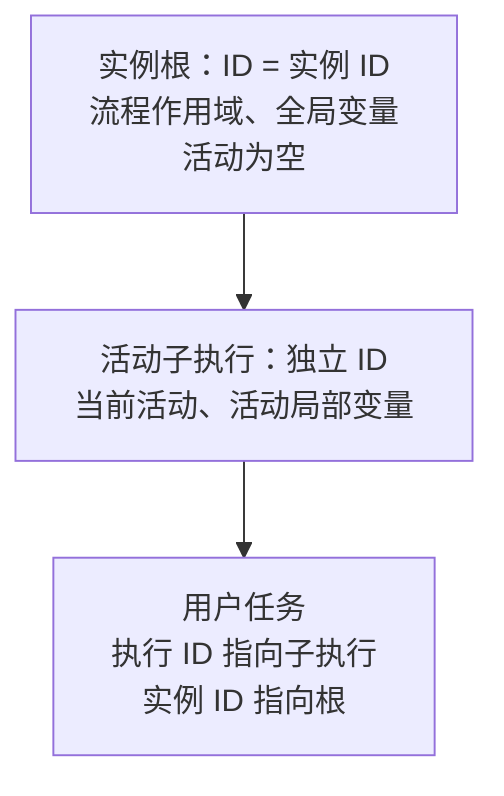

# 070 实例根与活动执行分离验收

## 1. 原版证据与问题

继续验收 M6 流程实例及执行接口时发现：新建 Go 流程把实例根和当前活动合并为同一执行；固定 Java 提交 `f6017e32a4bdd3e59a8881f58b0ee181652d1d9e` 实际保存独立的根执行和活动子执行。差异直接影响执行列表、父子引用、任务执行标识及局部变量边界，不能仅靠调整 JSON 字段解决。

现有真实 Java 制品 `testdata/compatibility/java/001-user-task-audit.json` 已包含明确证据：流程根 `4` 的 `ACT_ID_` 为 NULL、`IS_SCOPE_` 为 true；任务执行 `14` 的父标识为 `4`、活动为 `approve`、`IS_SCOPE_` 为 false；任务通过执行 `14` 关联实例 `4`。两条执行均为 active，业务键仅在根保存。

`TestJavaExecutionTopologyReference` 从固定制品读取实际 BPMN 与执行行，重新在 Go 部署和启动该模型，对比活动、父子关系、scope、active，再验证任务引用、局部变量、标准行空值、恢复和两步任务完成。首次测试明确失败于 Go 只有一个承载 `approve` 的根执行；修复后通过。

## 2. 新建实例结构



启动时先创建稳定根作用域，再在子执行上运行开始事件及后续活动。根保留流程变量和瞬态输入；活动通过父作用域读取全局值，局部写入保留在当前活动执行，不再污染实例变量。流程级监听器由根执行承担，活动监听器继续使用具体活动上下文。

根记录一个尚未结束的活动分支；活动容器没有剩余分支时递归结束父容器，最终关闭实例。该结束规则同时覆盖串行、并行及嵌套作用域，避免增加实例根后遗留永不结束的活动容器。

标准行导出将无活动根的 `ACT_ID_` 编码为 SQL NULL，子执行的 `BUSINESS_KEY_` 也为 NULL；只有流程根保存业务键。空字符串不能替代 SQL NULL，否则会改变数据库空值筛选语义。

## 3. 活动迁移与调用方

实例级单目标迁移不再把新活动直接写到根上。根仅有一个直接活动分支时沿该分支迁移；多个直接活动分支无法唯一选择时返回冲突。活动容器迁移前，统一取消后代任务、待执行作业及事件订阅，闭合活动历史并清理分支计数。

`TestChangeRootCancelsActivityTree` 从真实并行等待模型迁移到目标任务，验证只保留目标任务、根及全局变量保持稳定、旧任务带 `change-state` 删除原因闭合，目标完成后实例结束。

定向触发、消息、信号调用应使用实际承载活动或订阅的执行 ID。测试调用方已通过 `activityId` 和等待状态定位活动执行，禁止依赖排序将第一条执行或实例 ID 当作活动。根查询与变量 API 仍可使用实例根 ID。

## 4. 旧 Go 状态续跑

从改造前真实提交 `e77f836c27c1f614c370f2968762df3fa23f9906` 的独立源码归档运行公共 API，生成 `testdata/compatibility/go/001-single-root-state.json`。该样本实际只有一条承载等待任务的根执行，不是用新实现推导的旧版期望；来源和摘要见同目录 `provenance.json`。

`TestLegacySingleRootStateRestore` 分别验证原状态文件加载、重新导出行再恢复两条路径，核对旧执行标识、任务关联、业务键及变量，最终完成原任务。支持旧布局续跑不等于自动升级拓扑；本阶段不隐式重写存量执行标识，也不把这个简单样本扩大为全部旧版本格式兼容。

## 5. 验收方式

```bash
go test ./internal/engine -run 'TestJavaExecutionTopologyReference|TestLegacySingleRootStateRestore|TestChangeRootCancelsActivityTree' -count=1
make check
make race
make test-mysql
make test-postgres
make docs-check
```

普通回归覆盖并行、多实例、子流程、调用活动、定时器、事件子流程、瞬态变量、监听器、活动迁移和恢复。双库临时库验收补充检查：恢复后流程任务的执行标识必须不同于实例根，并能继续完成。真实数据库仍由独立环境显式启用，不连接或清理业务数据。

这项改造是流程实例和执行 REST 验收的前置修复，不新增已通过的原版 HTTP 方法数。当前仍为十四个方法、四十个原版 HTTP 场景；流程实例及执行响应、动作、错误、查询和完整字段组合继续按原版逐项验收，M6 保持进行中。
